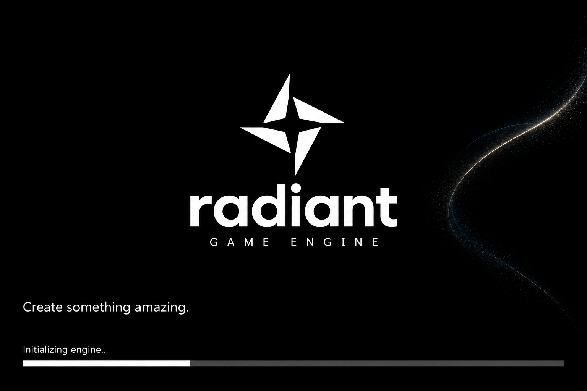
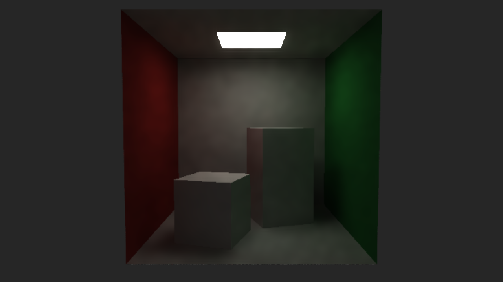
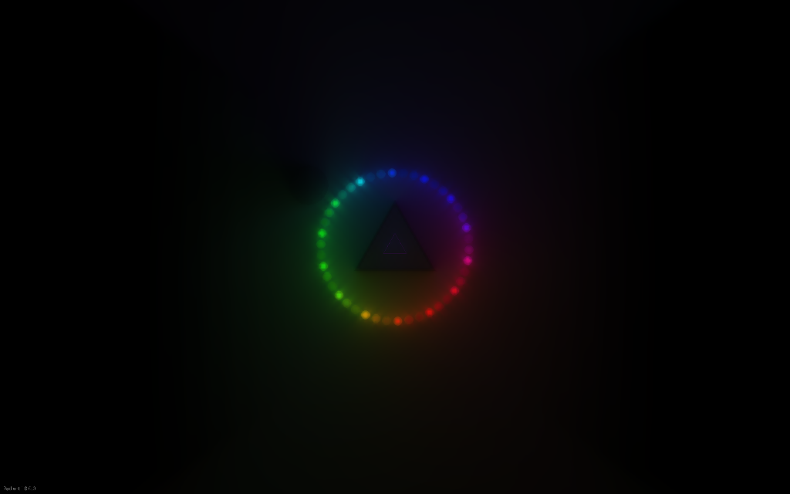
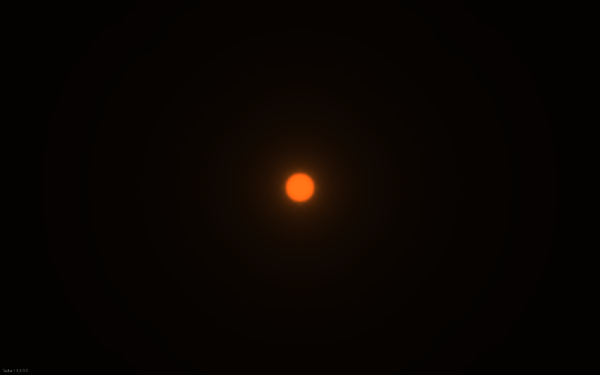

<h1 align="center">Radiant</h1>

<p align="center">
  <a href="https://github.com/lestercorderomurillo/radiant-game-engine/releases/tag/v0.3.1"></a>
  
  
  <a href="https://github.com/lestercorderomurillo/radiant-game-engine/actions/workflows/build.yml"></a>
</p>

[](docs/Startup.md)

A C# 2D and 3D game engine for experimenting with real-time lighting, built on MonoGame and Vulkan. Includes an archetype ECS, instanced geometry, radiance-cascade global illumination, and an in-game inspector.

## Startup

Desktop games open a temporary, borderless Radiant loader while the engine prepares the renderer,
systems and first scene. The white bar and status text reflect live loading stages.
**Help → About Radiant** opens the same artwork inside the engine, with a small themed close button.
The same screen accepts cancellable asynchronous preparation for future update checks
or downloads. [Startup options and updater integration](docs/Startup.md).

## Cornell Box (3D)



A Cornell Box with selectable flat, lit raster, and progressive diffuse path tracing. The demo starts maximized with path tracing selected and À-trous denoising enabled. AA, tonemapping and guided denoising are independent optional systems. F1 → View → Path tracing offers None, Joint bilateral, À-trous, temporal diffuse SVGF and optional OIDN neural denoising for either 2D or 3D. OIDN provides Fast/Balanced/High quality and CPU/GPU preferences through Neural denoising settings. Install its optional runtime with `python3 eng/install-oidn.py`, then rebuild/restart. Native vendor SDKs without integrations remain unavailable; see [denoising capabilities and costs](docs/Rendering.md#optional-path-denoising).

```sh
dotnet run --project tests/Radiant.3D -c Release
```

Left/right orbit within the open front of the room; up/down zoom. **R** switches renderers. **Tab** cycles final output and geometry buffers. **F1** opens Metrics, the 3D pipeline and the View menu with shared Color Management and Antialiasing windows, and the framework ECS inspection tools.

The [3D sample](src/com.radiant.engine/tests/3D/CornellBoxScene.cs) uses `Transform3D`, `Mesh3D`, and `Camera3D` components with a `Geometry3D` system. The [3D pipeline notes](docs/3D.md) describe its outputs and extension points.

## MegaLights

Orbiting lights, translucent obstacles, and a light that follows your mouse. Paint more lights or blockers and try the different upscalers.



## Run it

You'll need the **.NET 8 SDK or newer**, a Vulkan-capable GPU and driver, and a desktop session. On Linux, install the Vulkan loader and SDL2 dependencies too.

```sh
dotnet build radiant.sln -c Release
dotnet run --project tests/Radiant.Scenes -c Release --no-build -- triangles
```

The first build restores dependencies and compiles shaders and content.

| Control | Action |
| --- | --- |
| Mouse | Move the light |
| Left click / drag | Paint rainbow lights |
| Right click / drag | Paint blockers |
| Space | Pause or resume orbiting lights |
| F1 | Toggle the inspector |
| F11 | Cycle upscalers: Bilinear, UDR1, UDR2, UDR3, UDR4 |
| X | Add 100,000 lights for a stress test |
| Escape | Exit |

## Simple lighting

One warm light. A small example to start from.



```sh
dotnet run --project tests/Radiant.Scenes -c Release -- lights
```

## Modular 2D rendering

The same flat/raster/path tracing choices, AA and tonemappers also work with compact 2D components:

```sh
dotnet run --project tests/Radiant.Scenes -c Release -- rendering2d
```

R switches renderers; F1 opens the pipeline controls. View → Color Management and View → Antialiasing expose the same optional settings windows as 3D. Geometry AA supports MSAA and SSAA; post AA supports FXAA, SMAA and TAA. Exposure works with or without a tonemapper. A 2D-only game does not need 3D entity components or 3D systems. See [rendering architecture, API composition and migration](docs/Rendering.md).

## Build a game

Start with `new GameClient().Run(new MyScene())`. The runtime accepts an
`IRuntimeBackend`; simulation can also run with `HeadlessBackend` without a window.
Scenes and ECS systems receive Radiant's `FrameTime` and `Controls` for keyboard, mouse and text. See [runtime backends and API migration](docs/RuntimeBackends.md) and [Radiant input](docs/Input.md). Vectors and matrices use [System.Numerics](docs/Math.md), and meshes accept Radiant `MeshVertex` data. Colors, points, rectangles and colored vertices are Radiant types (`com.radiant.engine.math` / `ColorVertex`). [Render states](docs/RenderStates.md) use immutable Radiant descriptions.

Reference [`radiant.csproj`](radiant.csproj) and import [`eng/Radiant.Desktop.props`](eng/Radiant.Desktop.props) in your game project. Start with [SimpleLightScene.cs](src/com.radiant.engine/tests/2D/SimpleLightScene.cs) for scene setup, or [MegaLightsScene.cs](src/com.radiant.engine/tests/2D/MegaLightsScene.cs) for input and upscaling.

[raytracing-pacman](https://github.com/lestercorderomurillo/raytracing-pacman) is a game built with Radiant. For the lighting internals, see the [HRC implementation notes](docs/HRC.md).

## Tests

Headless checks:

```sh
dotnet run --project tests/Radiant.Tests -c Release
```

Rendering checks require a desktop session and Vulkan:

```sh
dotnet run --project tests/Radiant.Scenes -c Release -- triangles --smoke
dotnet run --project tests/Radiant.Scenes -c Release -- lights --smoke
dotnet run --project tests/Radiant.Scenes -c Release -- --lighting-regression
```

Smoke tests render each scene, check resizing, and save screenshots to `artifacts/smoke/`. See [HRC validation](docs/HRC.md#validation) for the lighting regression checks.

3D rendering and buffer regression checks (desktop/Vulkan):

```sh
dotnet run --project tests/Radiant.3D -c Release -- --smoke
dotnet run --project tests/Radiant.3D -c Release -- --regression
```

Modular rendering and denoising regressions (2D and 3D):

```sh
dotnet run --project tests/Radiant.3D -c Release -- --pipeline-regression
dotnet run --project tests/Radiant.3D -c Release -- --pipeline-regression --2d
dotnet run --project tests/Radiant.3D -c Release -- --advanced-denoising-regression
dotnet run --project tests/Radiant.3D -c Release -- --advanced-denoising-regression --2d
```

AA and stationary raster visibility checks:

```sh
dotnet run --project tests/Radiant.3D -c Release -- --raster-stability
dotnet run --project tests/Radiant.3D -c Release -- --aa-regression
dotnet run --project tests/Radiant.3D -c Release -- --aa-regression --2d
```

Capture the 3D showcase at 1280×720 after 128 progressive samples (desktop/Vulkan):

```sh
dotnet run --project tests/Radiant.3D -c Release -- --capture
```

The unedited final frame is saved to `artifacts/showcase/cornell-box.png`.
