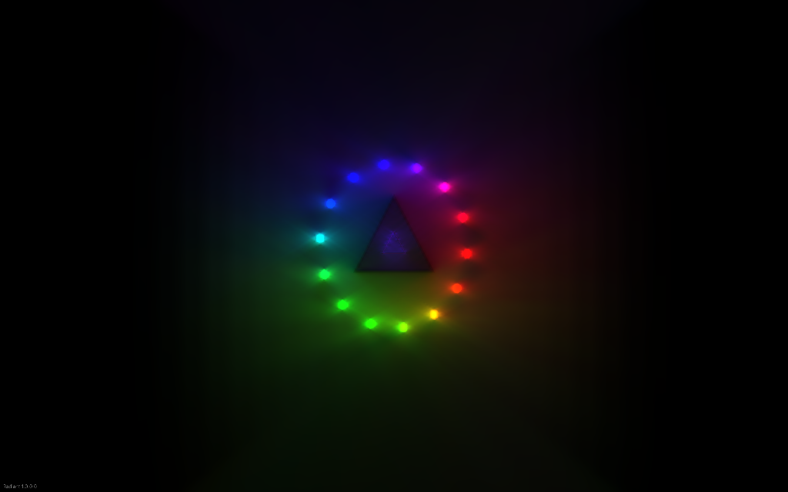
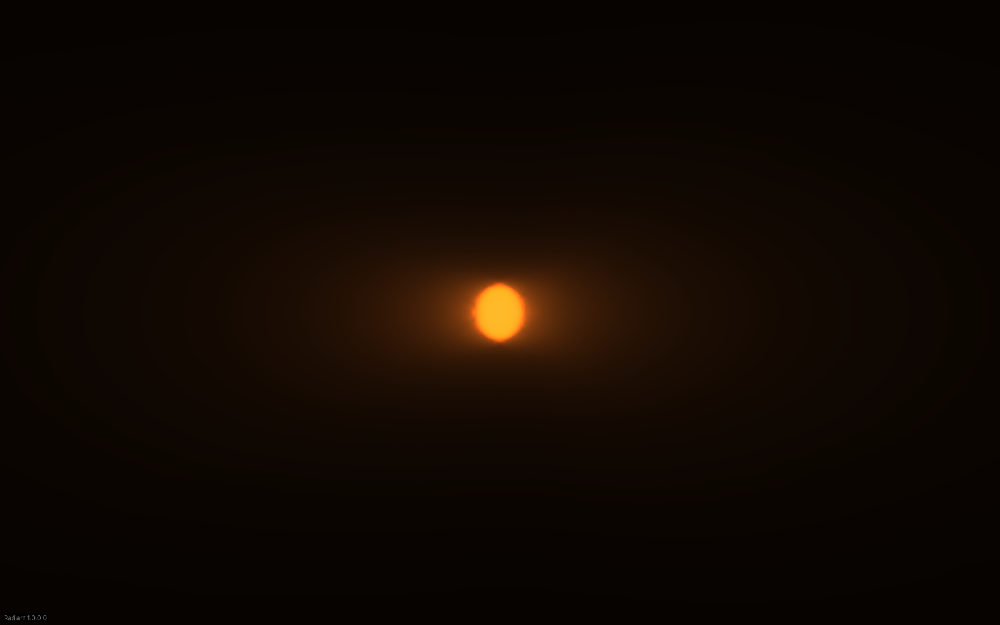

# Radiant

**A C# 2D engine for experimenting with real-time lighting.** Radiant combines an archetype ECS, instanced geometry, holographic radiance-cascade global illumination, spatial and temporal upscaling, and runtime inspection on MonoGame's native Vulkan backend.

The engine is a reusable library. The demos in this repository are standalone consumers; [raytracing-pacman](https://github.com/lestercorderomurillo/raytracing-pacman) is a separate game built on it.

## MegaLights — the triangle lighting demo



The original **MegaLightsScene** pairs a purple emissive triangle and a larger dark triangle with **14 orbiting rainbow lights**, translucent occluders, and a mouse-controlled light. Paint additional lights or blockers, pause the orbit, and compare the upscaling implementations interactively.

This scene was replaced by the maze demo in commit `a6beaed` (February 7, 2026), then renamed and eventually developed into Pac-Man. It is restored here from the version immediately before that replacement, with adaptations for the current engine API.

```sh
dotnet run --project tests/Radiant.Scenes -c Release -- triangles
```

| Control | Action |
| --- | --- |
| Mouse movement | Move the mouse light |
| Left mouse button / drag | Paint rainbow lights |
| Right mouse button / drag | Paint black blockers |
| Space | Pause or resume orbiting lights |
| F11 | Cycle Bilinear, UDR1, UDR2, and UDR3 upscaling |
| X | Add 100,000 small random lights for a stress test |
| Escape | Exit |

## Quick start

Use the **.NET 8 SDK or newer**, a Vulkan-capable GPU and driver, and a graphical desktop session. The projects target `net8.0` and allow newer installed runtimes through `RollForward=Major`. Linux also needs the Vulkan loader and SDL2 dependencies.

Run these commands from the repository root:

```sh
dotnet build radiant.sln -c Release
dotnet run --project tests/Radiant.Scenes -c Release --no-build -- triangles
```

The first build restores NuGet packages and the local MGCB tool, then compiles the engine's shaders and content. MonoGame supplies the native runtime and shader compiler through NuGet; Wine is not required. The project references MonoGame **3.8.6 DesktopVK** runtimes for Linux, Windows, and macOS. The captures below were validated on Linux; they are not evidence of testing on every platform.

`radiant.csproj` builds the engine library. `tests/Radiant.Scenes` builds the executable scene runner; running the library project directly will not launch a window.

## Simple lighting reference



`SimpleLightScene` is the smallest lighting example: one warm emissive circle rendered through `Geometry → HRCGI → Bilinear`. It is useful for checking shader loading, light initialization, and resizing before working with a larger scene.

```sh
dotnet run --project tests/Radiant.Scenes -c Release -- lights
```

Both images are actual scene-render-target captures from the Vulkan smoke tests, at **1024 × 640 after resizing**. They are not mockups or full desktop screenshots.

## What the engine provides

| Area | Implementation |
| --- | --- |
| Entity model | Archetype ECS, component queries, spatial lookups, and scene-owned systems |
| Geometry | Instanced rectangles, circles, and triangles with emissive and absorption materials |
| Lighting | Holographic Radiance Cascades (HRCGI) |
| Upscaling | Bilinear and UDR1 / UDR2 / UDR3 implementations |
| Runtime | Window hosting, update/fixed-update/render hooks, resize handling, and resource disposal |
| Development tools | Inspector, gizmos, and performance monitoring systems |
| Supporting systems | Procedural world generation, tile rendering, and networking code |

Scenes select and register their systems explicitly. See [SimpleLightScene.cs](src/com.radiant.engine/tests/2D/SimpleLightScene.cs) for a small example and [MegaLightsScene.cs](src/com.radiant.engine/tests/2D/MegaLightsScene.cs) for interactive lighting and upscaler switching.

## Use Radiant in a game

For a sibling game repository, import the shared desktop settings and reference the engine:

```xml
<Project Sdk="Microsoft.NET.Sdk">
  <Import Project="../radiant-game-engine/eng/Radiant.Desktop.props" />
  <PropertyGroup>
    <OutputType>Exe</OutputType>
  </PropertyGroup>
  <ItemGroup>
    <ProjectReference Include="../radiant-game-engine/radiant.csproj" />
  </ItemGroup>
</Project>
```

A minimal `Program.cs` can define and launch a lighting scene:

```csharp
using com.radiant.engine.bundle;
using com.radiant.engine.core;
using com.radiant.engine.runtime;
using Microsoft.Xna.Framework;

new GameClient().Run(new MyScene(), new WindowOptions
{
    Title = "My Radiant game",
    Width = 1280,
    Height = 720
});

sealed class MyScene : Scene
{
    private HRCGI lighting;
    private Bilinear upscale;

    public override void SetupECS()
    {
        ECS.AddSystem<Geometry>();
        lighting = ECS.AddSystem<HRCGI>();
        upscale = ECS.AddSystem<Bilinear>();
        base.SetupECS();
    }

    public override void SetupScene()
    {
        LightFactory.CreateLight(ECS, Renderer.VirtualSize / 2,
            100f, Color.Orange, Color.Orange, 0f);
        upscale.SetInputSource(lighting.GetOutput);
        base.SetupScene();
    }
}
```

Register systems before calling `base.SetupECS()`, which initializes them. Create entities in `SetupScene()`. Override `Update()`, `FixedUpdate()`, `Render()`, or `LateRender()` for scene behavior; `ECS`, `Renderer`, and `DeltaTime` are available on the scene. The game loop owns and disposes the active scene and renderer.

Use `Renderer.FitWorld(center, size)` to keep a world area centered and fully visible through window resizing while preserving its proportions. Shapes and coordinate conversions follow the fitted view; use `Renderer.WorldTransform` for world-space sprites.

Games with their own content add a `MonoGameContentReference` and a local MGCB tool manifest matching the engine version. Engine shaders, fonts, and inspector icons flow through the project reference into build and publish output. Content is resolved relative to the executable, so published applications can launch from another working directory.

## Tests and screenshot capture

The headless checks need no display or GPU:

```sh
dotnet run --project tests/Radiant.Tests -c Release
```

They verify 2,048 generated tiles, component data after archetype migration, spatial lookups, light creation, and the portable timer lifecycle. This project is an executable check suite, so run it with `dotnet run`.

Capture and validate the featured scenes with a display and Vulkan available:

```sh
dotnet run --project tests/Radiant.Scenes -c Release -- triangles --smoke
dotnet run --project tests/Radiant.Scenes -c Release -- lights --smoke
```

Each smoke run loads real content, renders **90 frames**, captures frame 10 at **960 × 540**, resizes the window, captures frame 90 at **1024 × 640**, checks the renderer dimensions and nonempty pixels, and exits. A failed assertion terminates the process with an error. These are basic rendering checks, not pixel-perfect visual regression tests or benchmarks.

| Scene | Captures under `artifacts/smoke/` |
| --- | --- |
| MegaLights | `MegaLightsScene-initial.png`, `MegaLightsScene-resized.png` |
| Simple lighting | `SimpleLightScene-initial.png`, `SimpleLightScene-resized.png` |

The output path is relative to the working directory. `artifacts/` is ignored by Git; README images are retained separately under `docs/images/`. To refresh the gallery after successful smoke runs:

```sh
mkdir -p docs/images
cp artifacts/smoke/MegaLightsScene-resized.png docs/images/
cp artifacts/smoke/SimpleLightScene-resized.png docs/images/
```

Linux CI builds the solution and shaders and runs the headless checks. Graphical smoke tests run locally and require a desktop session. Captures checked on **October 21, 2026**, using an **AMD Radeon RX 9070 XT** with RADV on Linux.

## Repository map

| Path | Purpose |
| --- | --- |
| [`src/com.radiant.engine/core`](src/com.radiant.engine/core) | ECS, scenes, rendering primitives, and resource management |
| [`src/com.radiant.engine/bundle`](src/com.radiant.engine/bundle) | Components and reusable rendering, lighting, world, and UI systems |
| [`src/com.radiant.engine/runtime`](src/com.radiant.engine/runtime) | Game client, window, and game loop |
| [`src/com.radiant.engine/mplay`](src/com.radiant.engine/mplay) | Networking code |
| [`Content`](Content) | Shared shaders, Inter fonts, and inspector icons |
| [`src/com.radiant.engine/tests/2D`](src/com.radiant.engine/tests/2D) | Demo scene implementations, excluded from the engine library |
| [`tests`](tests) | Headless checks, graphical runner, and shared smoke harness |
| [`eng/Radiant.Desktop.props`](eng/Radiant.Desktop.props) | Framework, MonoGame version, backend, and content build settings |
| [`docs/images`](docs/images) | Captured scene images used in this README |

## Development notes

Open the folder in VS Code to load `radiant.sln` through C# Dev Kit. **Ctrl+Shift+B** builds the solution. Existing F5 launch configurations are in [`.vscode/launch.json`](.vscode/launch.json); the commands above also launch scenes directly.

Shader profiles are `vs_6_0` / `ps_6_0`, with `SV_Target` pixel outputs. DesktopVK currently permits one constant buffer per effect. Keep MonoGame package versions and [`.config/dotnet-tools.json`](.config/dotnet-tools.json) aligned. MGCB validates `.fx` shaders during content builds.

If a graphical run fails, first check that it is running in a graphical session with a working Vulkan driver. If shaders or content are missing, rebuild the solution and check MGCB output. The headless checks can run independently of graphics initialization.
