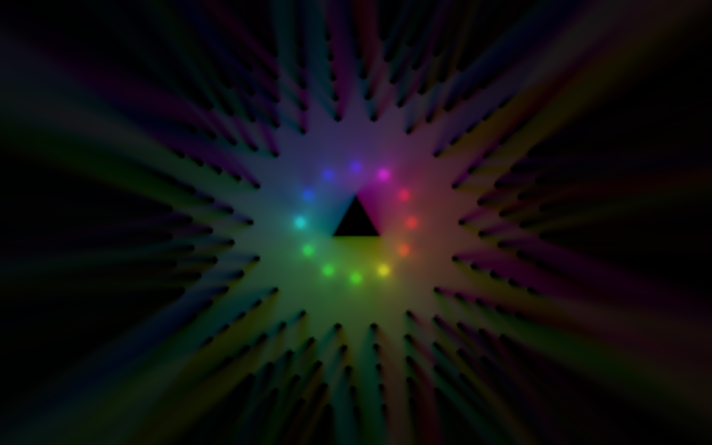
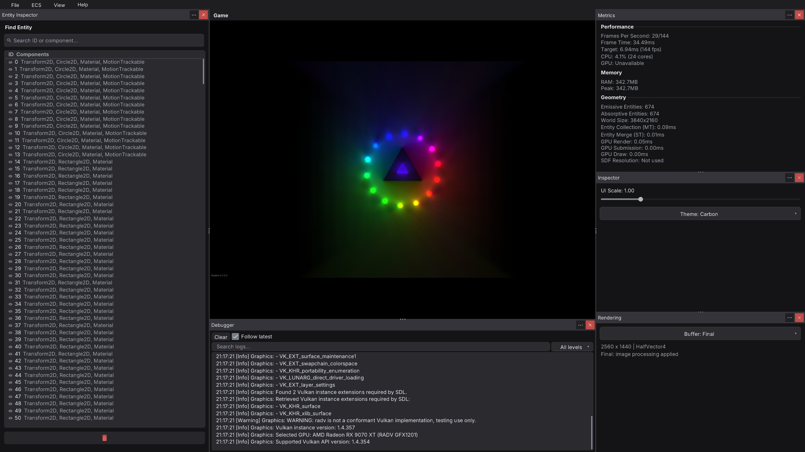

<h1 align="center">Radiant</h1>

<p align="center">
  <a href="https://github.com/lestercorderomurillo/radiant-game-engine/releases/tag/v0.9.0"></a>
  
  
</p>

[](https://github.com/lestercorderomurillo/radiant-game-engine/releases/tag/v0.9.0)

A C# engine for 2D and 3D games, with an entity-component system, composable rendering pipelines,
global illumination and live inspection tools.

Build a scene in code and register the debugging collection to inspect entities, tune rendering and read diagnostics.
Tools open as docked panels with Show All enabled; **F1** hides or restores them.

## Features

- **ECS architecture**: a modern entity-component-system core built for massive worlds.
- **Scenes**: build scenes in code or design them statically, in 2D or 3D.
- **Rendering**: composable pipelines for flat, lit or path-traced images, in 2D and 3D.
- **Global illumination**: path-traced lighting with hardware ray tracing and experimental 3D radiance cascades.
- **Tone mapping**: HDR rendering with filmic tone mapping and color management.
- **Anti-aliasing**: MSAA, SSAA, FXAA, SMAA and TAA, selectable per project.
- **Neural denoising**: clean path-traced images at low sample counts.
- **UDR**: Universal Detail Reconstruction, an in-house upscaler for higher frame rates.
- **Spatial lookups**: query by radius, box, position or nearest neighbours at near-zero cost.
- **Automatic dependency resolution**: declare system order once, the engine schedules the rest.
- **System control**: pause, group and switch systems at runtime.
- **Runtime**: keyboard, mouse and text input, fixed timestep, headless mode, compute shaders.
- **Agentic development**: MCP and AI-assisted workflows for iteration and content generation.
- **Inspector**: movable panels, live entity editing, a free camera and searchable diagnostics.
- **Asset Studio**: create shaders, sprites and 3D models directly in the engine.
- **Visual graph**: build shaders, materials and gameplay logic with a node-based editor.
- **Blender integration**: move assets between Blender and your project seamlessly.
- **Plugin system**: extend the engine and its tools with your own plugins.

## Get Radiant

**[Download v0.9.0 source](https://github.com/lestercorderomurillo/radiant-game-engine/archive/refs/tags/v0.9.0.zip)** · [Release notes](https://github.com/lestercorderomurillo/radiant-game-engine/releases/tag/v0.9.0)

You need the .NET 8 SDK or newer and a Vulkan-capable GPU. On Linux, also install the Vulkan loader and SDL2.

Add Radiant to your game project:

```xml
<Project Sdk="Microsoft.NET.Sdk">
  <Import Project="../radiant-game-engine/eng/Radiant.Desktop.props" />
  <PropertyGroup>
    <OutputType>Exe</OutputType>
  </PropertyGroup>
  <ItemGroup>
    <ProjectReference Include="../radiant-game-engine/radiant.csproj" />
  </ItemGroup>
</Project>
```

Run the interactive radiance demo from this repository (also the default scene):

```bash
dotnet run --project tests/Radiant.Scenes -- radiance
```

Twelve colored lights orbit close to a nonemissive central triangle, with 150 dots distributed across five staggered rings farther out. Paint or erase dots while
Holographic Radiance Cascades updates their lighting and shadows. Exposure is **2.7×**, with sRGB output.



| Control | Action |
| --- | --- |
| Left click / drag | Place dark dots that block light. |
| Right click / drag | Erase dots, including the initial field. |
| Space | Pause or resume moving lights. |
| R | Restore the initial field and lights. |
| F1 | Hide or show the Inspector. |
| F11 | Cycle reconstruction modes. |

Painting respects the game viewport and Inspector panels. The brush supports up to 4,096 dots.
The scene lives in [RadianceScene.cs](src/com.radiant.engine/tests/2D/RadianceScene.cs), with shared image stages
in [DemoRendering.cs](src/com.radiant.engine/tests/2D/DemoRendering.cs).

Other examples: `rendering2d` compares 2D rendering techniques, `tiles` shows procedural terrain,
and `dotnet run --project tests/Radiant.3D` opens the Cornell Box.
See the [quickstart](docs/GettingStarted.md) to reuse the radiance scene in your own project.

Register the same debugging tools in any scene:

```csharp
ECS.AddSystemCollection(SystemCollections.Debugging);
```

This adds Inspector, Profiling and Gizmos, with entity/component/system editors, logs and shared camera controls.
Camera Controls discovers 2D/3D entity cameras, fitted 2D views and the tile viewport. All four examples use this collection.

## Work with the Inspector

Panels with **Show All** is the default for every Inspector. Entity Inspector opens on the left,
the game stays in the center, and Debugger shows diagnostics below it. Side panels stack vertically
so you can use them together. When space runs out, only the panels that need it share tabs.



| Control | What it does |
| --- | --- |
| **…** beside a tab | Move the panel left, right or below Game; reset panel sizes; or close it. |
| **X** | Close that panel. Open it again from **View**. |
| Tab title | Select a panel. Hold and drag it to move it; the highlighted area marks the destination. |
| Divider grip | Resize the adjacent panels. |
| **Clear** | Remove every retained log message, including messages hidden by a filter. |
| **Follow latest** | Scroll when new messages arrive; idle frames preserve your position. Turn it off to keep reading older entries as messages arrive. |
| **Search logs…** | Find text in messages, sources or the displayed timestamp. |
| **All levels** | Show all messages, or only Info, Warnings or Errors. Works together with search. |

Choose **View → Workspace Mode → Windows** for floating tools. Drag a window's title to move it
or its bottom-right corner to resize it. **F1** hides the tools and returns the game to the full window.

[Inspector guide: arrange panels, inspect entities and read logs](docs/Inspector.md)

## Documentation

**[Read the Radiant documentation](https://lestercorderomurillo.github.io/radiant-game-engine/)**: guides for every
feature and the complete C# API reference.

- [Quickstart](docs/GettingStarted.md)
- [ECS architecture](docs/ECS.md), [scenes](docs/Scenes.md) and [systems](docs/Systems.md)
- [Input](docs/Input.md) and [inspector](docs/Inspector.md)
- [Renderer](docs/Renderer.md) and [lighting](docs/HRC.md)
- [Rendering pipelines](docs/Rendering.md) and [3D rendering](docs/3D.md)
