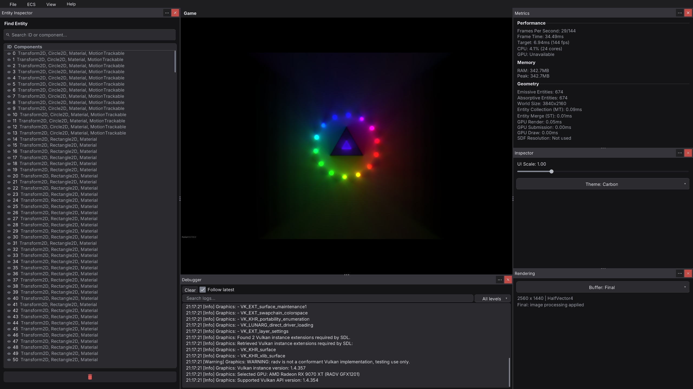
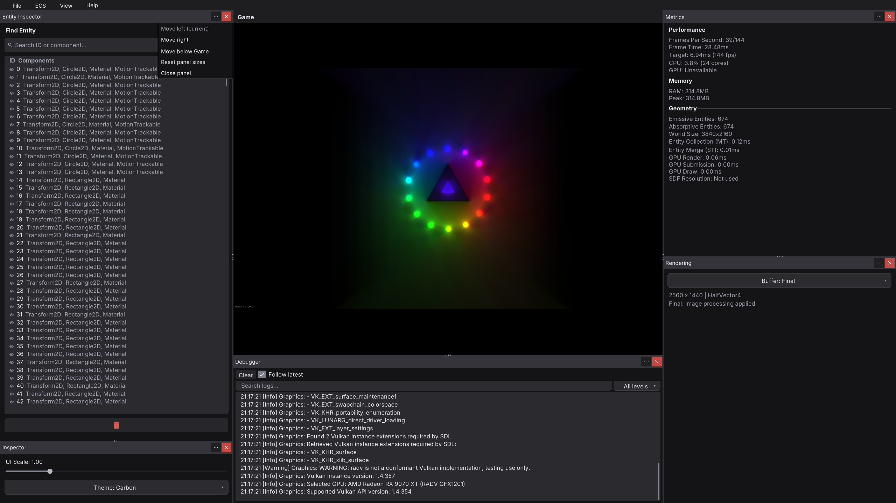
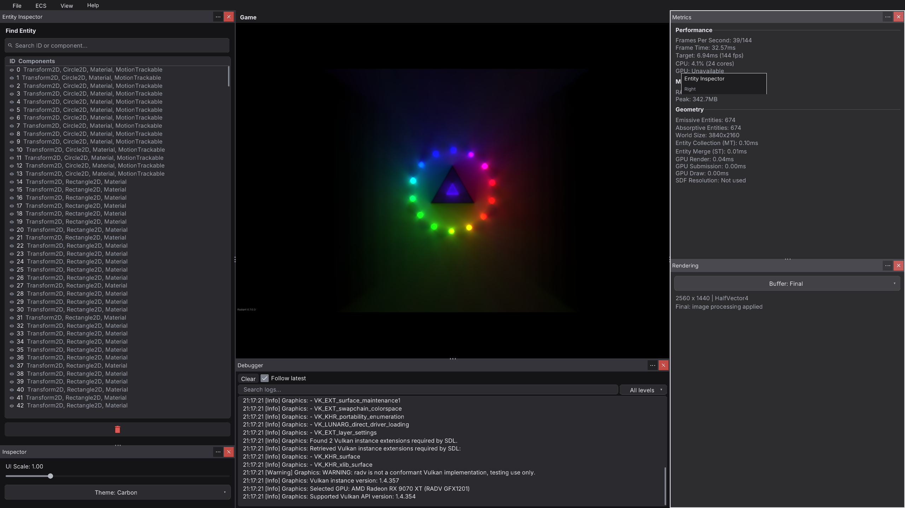
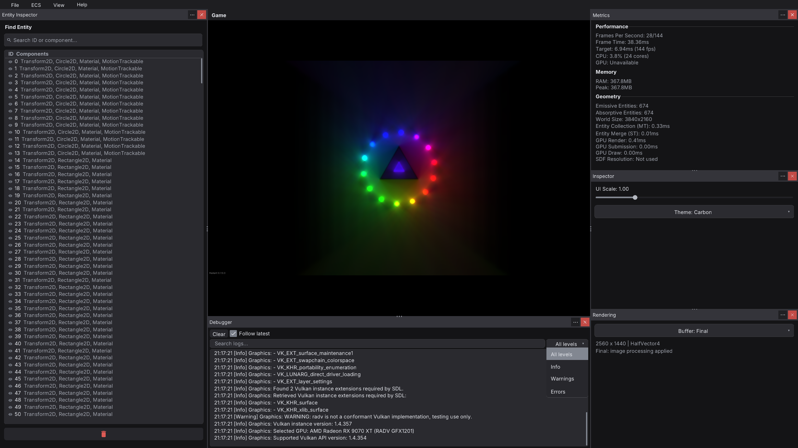

# Inspector

Build in-game tuning and debug panels in a few lines: sliders, toggles, dropdowns, text fields and lists inside
draggable windows. Press **F1** to show or hide them.

Add the [`Inspector`](../src/com.radiant.engine/bundle/Systems/UI/Inspector/Inspector.cs) system to your scene.
Use its static widget helpers to build panels, then keep diagnostic overlays in the Gizmos section below.

## Open the workspace

Press **F1** while the game is running, then choose **View → Workspace Mode → Panels**.
Entity Inspector appears on the left, Game occupies the center, and Debugger opens below Game.
Tools stack vertically within each side dock, so their controls stay visible together. When there is not enough height, only the panels that need it share a tab group. Click a tab title to select a panel in that group.



**F1** hides the tools and gives the game the full window. Press it again to return to your workspace.
To change text and control sizes, open the **Inspector** panel from **View** and adjust **UI Scale**.
The **Theme** dropdown changes the workspace colors.

## Arrange panels

Use the **…** button beside a panel's X when you want to move it without dragging.



| Menu action | Result |
| --- | --- |
| **Move left** | Put the panel in the left dock and select its tab. |
| **Move right** | Put the panel in the right dock and select its tab. |
| **Move below Game** | Put the panel in the bottom dock, alongside Debugger. |
| **Reset panel sizes** | Restore the default left, right and bottom proportions. Panels keep their assigned docks. |
| **Close panel** | Hide the panel. Its entry in **View** opens it again. |

The menu marks the panel's current dock. Use **↑** or **↓** to choose an action and **Enter** to apply it.
**Escape** or a click outside the menu dismisses it.

To move a panel with the mouse, hold its tab title and drag. Drop on another tab to change the order,
on a panel body to join that dock, or on an empty workspace edge to open a dock there.
The title follows the pointer and the destination is outlined before you release. **Escape** cancels the move.



Drag a divider's grip to change the space given to adjacent panels, including panels stacked in the same dock. The horizontal grip above Debugger
changes its height. Scroll over a panel's controls when they do not all fit; scroll inside a list to browse its rows.

The square **X** closes only its own panel. Choose its name from **View** to reopen it.

## Read diagnostics

Debugger retains the latest 2,000 log lines across scene changes. Graphics startup messages, including Vulkan
diagnostics, appear here. Each line shows its time, severity, source and message.



| Control | How to use it |
| --- | --- |
| **Clear** | Empty the entire retained log. Search and severity settings stay selected. |
| **Follow latest** | Keep the newest matching lines visible as messages arrive. Turn it off before scrolling back. |
| **Search logs…** | Match part of a message, source, severity or displayed time. Search ignores letter case. Use the small X in the field to clear the search. |
| **All levels** | Include every severity. Select **Info**, **Warnings** or **Errors** to show only that level. |
| List scrollbar | Browse older matching messages with Follow latest off. |

For example, choose **Warnings** and type `Graphics` to read warnings from graphics initialization.
Choose **All levels** and clear the search field to show the whole retained log again.
The severity menu opens upward when there is not enough room beneath it.

Write messages from game code with `EngineLog`:

```csharp
using com.radiant.engine.core;

EngineLog.Write("Level loaded", source: "Scene");
EngineLog.Write("No spawn point found", LogLevel.Warning, "World");
EngineLog.Write("Save failed", LogLevel.Error, "Save");
```

## Use floating windows

Choose **View → Workspace Mode → Windows** to restore the floating arrangement.
Drag a title bar to move a window and the **bottom-right grip** to resize it in both directions.
Contents stay inside the window; scroll over its controls to reach anything below the visible area.

Close a window with **X** and reopen it from **View**. **View → Reorder Windows** arranges the windows again.
Switch back to **Panels** when you want tools docked around Game.

## Windows and widgets

Create windows and widgets once (in `Initialize` or `SetupScene`), then update their values every frame.

Create a lighting panel with controls bound to your game state:

```csharp
Inspector.CreateWindow("lighting", "Lighting");
Inspector.AddLabel("lighting", "fps", "FPS: --");
Inspector.AddSlider("lighting", "radius", "Radius", 10f, 400f, 100f, value => Radius = value);
Inspector.AddToggle("lighting", "shadows", "Shadows", true, enabled => Shadows = enabled);
Inspector.AddDropdown("lighting", "quality", "Quality", ["Low", "Medium", "High"], 1, index => Quality = index);
Inspector.AddButton("lighting", "reset", "Reset", Reset);
```

Update the label during the frame:

```csharp
public override void Update()
{
    Inspector.SetLabel("lighting", "fps", $"FPS: {1f / Time.DeltaSeconds:0}");
}
```

Setters mirror each widget: `SetSliderValue`, `SetToggleValue`, `SetDropdownValue`, `SetDropdownOptions`,
`SetTextInputValue` and `SetListBoxItems`. `SetWidgetEnabled` greys out a widget, and `RemoveWidget` or
`DestroyWindow` removes it.

### Inline rows

Widgets with an inline ratio share a row. The following example shows how to build a search bar from a text
field and a button; empty button text shows a search icon:

```csharp
Inspector.AddTextInput("entities", "query", "Search…", text => Filter = text, 0.8f);
Inspector.AddButton("entities", "go", "", Search, 0.2f);
```

### List boxes

`AddListBox` shows a scrollable, selectable list. `SetListBoxHeader` adds a fixed header row (columns are
separated by `"  |  "`), `GetListBoxSelected` returns the selected indices, and `ClearListBoxSelection` resets them.

## Visibility and layout

`ShowWindow`, `HideWindow`, `ToggleWindow` and `IsWindowVisible` control windows by ID. Windows are
repositioned only when the game window is resized, the UI scale changes, or **View → Reorder Windows** runs,
which also raises `Inspector.WindowsRestored`.

The following example shows how to keep world clicks and shortcuts from firing through the UI:

```csharp
if (Controls.WasPressed(MouseButton.Left) && !Inspector.IsMouseOverUI()) Select(cursor);
if (!Inspector.IsEditingText && Controls.WasPressed(Key.R)) Restart();
```

## Menu bar

- **File** — close the application.
- **ECS** — entity, component and system inspectors, plus the shared camera controls.
- **View** — every registered window, with Show All, Hide All and Reorder Windows.
- **Help** — About Radiant.

`Inspector.OpenCameraControls()` opens the [camera controller](CameraControls.md) directly.

## Themes

Built-in themes: Carbon (default), Solaris, Midnight, Sentinel (light), Greenfields, Neon and Nord. Register
your own with `RegisterTheme(name, theme)` and switch with `ApplyTheme(name)`.

## Draw gizmos

[`GizmosRenderer`](../src/com.radiant.engine/bundle/Systems/UI/Gizmos/GizmosRenderer.cs) draws diagnostic
shapes and labels over the scene. The following example shows how to queue gizmos from a system's `Render`:

```csharp
var gizmos = ECS.GetSystem<GizmosRenderer>();
gizmos.AddGizmoLine(start, end, Color.Gold, thickness: 2f);
gizmos.AddGizmoCircle(center, radius, Color.Lime);
gizmos.AddGizmoRect(bounds, Color.Red, filled: false);
gizmos.AddGizmoText(position, "spawn", Color.White);
gizmos.ToggleGizmos();
```

`PerformanceMonitor` adds frame-time, CPU and GPU metrics windows; GPU counters are available on Windows only.

## Continue

- [Input](Input.md) — read controls and respect UI focus.
- [Cameras](CameraControls.md) — navigate the scene while inspecting it.
- [Image quality](RenderingPipeline.md) — inspect lighting and reconstruction buffers.
